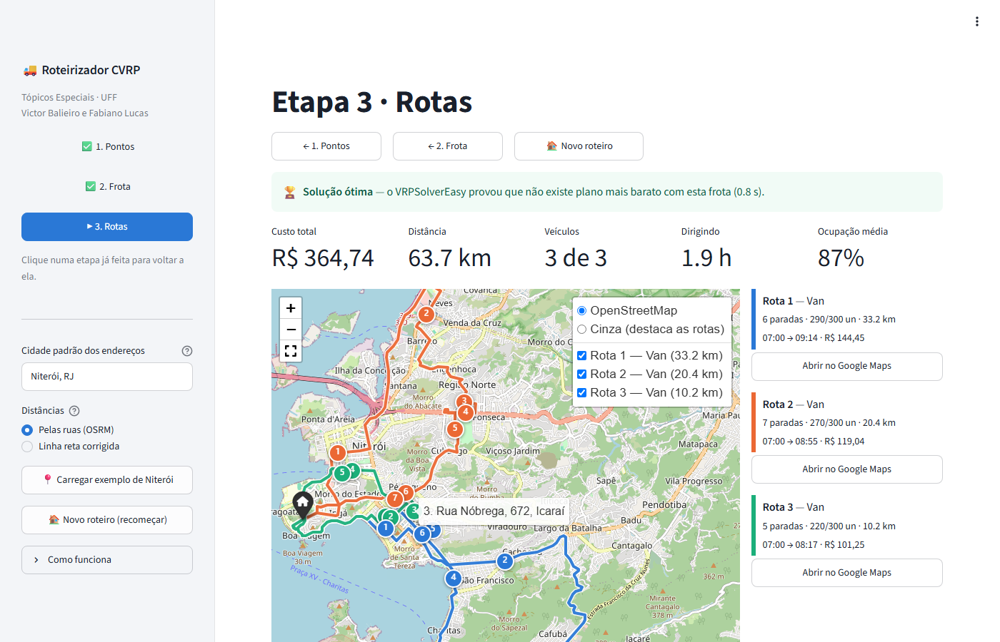

# Roteirizador CVRP

Trabalho final de Tópicos Especiais — Prof. Eduardo Rocha (UFF).
Victor Balieiro e Fabiano Lucas.

Aplicativo web que transforma uma lista de **endereços** e uma **frota** num
**plano de rotas** desenhado no mapa, pronto para o motorista abrir no celular.

```
Etapa 1  endereços  →  coordenadas  →  distâncias e tempos pelas ruas
Etapa 2  frota: tipos de veículo, capacidade, quantidade, custos, depósito, jornada
Etapa 3  GRASP + VRPSolverEasy  →  rotas no mapa, ordem de visita, Excel, Google Maps
```



---

## O que este roteirizador faz além do exemplo

| | Exemplo da disciplina | Este trabalho |
|---|---|---|
| Entrada dos pontos | tabela | tabela **ou** planilha CSV/Excel, com exemplo pronto |
| Geocodificação | automática | automática **com conferência no mapa e correção manual** das coordenadas; serviço de reserva |
| Distâncias | — | **pelas ruas** (OSRM), em km e minutos, **assimétricas** (mão única) |
| Frota | um tipo, custo por km | vários tipos, **custo fixo + por km + por hora**, cada um com seu depósito e **jornada** |
| Restrições | capacidade | capacidade, tempo de parada em cada cliente, **jornada** dos veículos, rota aberta |
| Algoritmo | VRPSolverEasy | **GRASP (trabalho 4) + VRPSolverEasy**: a heurística dá a solução de partida e o solver melhora ou **prova a otimalidade** |
| Qualidade da resposta | status | status, **limitante inferior e gap** quando não fecha o ótimo |
| Resultado | mapa | mapa por ruas com **paradas numeradas** e camadas por veículo; horário de chegada em cada parada; ocupação |
| Saída | — | **Excel** do plano e **link do Google Maps** de cada rota |

---

## Como usar

1. **Pontos** — digite os endereços (ou importe uma planilha, ou clique em
   *Carregar exemplo de Niterói*). Marque o depósito. Na barra lateral,
   escolha a **cidade padrão** (a setinha mostra outras cidades, e dá para
   digitar qualquer uma) e clique em **Aplicar**. Clique em
   **Geocodificar**, confira os pontos no mapa e corrija a latitude/longitude
   de algum que tenha caído no lugar errado.
2. **Frota** — cadastre os tipos de veículo e escolha se eles voltam ao
   depósito. O botão **ⓘ** explica cada coluna, com um exemplo de como o custo
   é calculado.
3. **Rotas** — o mapa mostra cada veículo numa cor, com as paradas numeradas
   na ordem de visita. Clique numa parada para ver o horário de chegada.
   Baixe o plano em Excel ou abra a rota direto no Google Maps.

Os botões no topo de cada tela (e as etapas na barra lateral) voltam às etapas
anteriores sem perder o que foi preenchido; **🏠 Novo roteiro** apaga tudo e
volta à tela inicial.

---

## Como rodar

```bash
python -m venv .venv
.venv\Scripts\activate              # Windows   (Linux/Mac: source .venv/bin/activate)
pip install -r requirements.txt
streamlit run app.py
```

Testes:

```bash
python validar.py          # modelo, GRASP e solver (inclui força bruta)
python validar.py --app    # e também o fluxo completo da interface
```

### Publicar no Streamlit Community Cloud

1. Envie esta pasta para um repositório no GitHub (sem a pasta `.venv`).
2. Em <https://share.streamlit.io>, entre com a conta do GitHub e clique em
   **Create app**.
3. Escolha o repositório, o ramo `main` e o arquivo **`app.py`**. Em
   *Advanced settings*, selecione **Python 3.12**.
4. **Deploy**. A primeira instalação leva alguns minutos.

---

## Arquitetura

| Arquivo | Responsabilidade |
|---|---|
| `app.py` | Interface Streamlit: as três etapas e a tela de resultado |
| `geo.py` | Geocodificação (Nominatim, Photon de reserva, cache em disco), matriz de distâncias e tempos (OSRM), traçado das rotas |
| `modelo.py` | O problema (`Problema`, `TipoVeiculo`) e **a única regra de custo e viabilidade** (`avaliar_rota`) |
| `solver.py` | Modelagem no VRPSolverEasy, execução isolada num processo, resolução em duas fases |
| `heuristica.py` | GRASP: inserção mais barata aleatorizada + busca local (2-opt, troca(0,1), troca(1,1), troca de veículo) |
| `mapa.py` | Mapa Folium: rotas pelas ruas, paradas numeradas, camadas por veículo |
| `exportar.py` | Planilha Excel e links do Google Maps |
| `validar.py` | Testes, incluindo comparação do solver com força bruta |

O solver e a heurística são conferidos pela **mesma** função `avaliar_rota`.
Se cada um calculasse custo do seu jeito, a comparação entre eles não valeria
nada.

---

## Decisões de projeto

### Por que GRASP *e* VRPSolverEasy

O GRASP do trabalho 4 acha uma boa solução em poucos segundos, para qualquer
tamanho. O VRPSolverEasy (*branch-cut-and-price*, Pessoa, Sadykov, Uchoa e
Vanderbeck, 2020) acha o ótimo, mas o tempo cresce rápido. Juntos:

1. o GRASP roda primeiro;
2. o custo dele entra no VRPSolverEasy como **limitante superior**: o solver
   descarta de cara toda solução pior;
3. se o solver concluir que não existe nada melhor, isso **prova** que o GRASP
   achou o ótimo. Se não der tempo, o app mostra o **limitante inferior** e o
   **gap** — quanto, no máximo, a solução pode estar acima do ótimo.

No exemplo de Niterói, o GRASP chega a R$ 364,74 e o VRPSolverEasy prova em
cerca de 1 s que esse é o ótimo.

### Distâncias pelas ruas

Em Niterói, medindo nos 21 endereços do exemplo, o caminho pelas ruas é em
média **1,56 vez** a linha reta, e ir de A a B chega a ser **2,3 km** mais
longo que voltar (mão única). Por isso a matriz vem do OSRM, e é usada como
assimétrica tanto no solver (arcos direcionados) quanto no GRASP. A linha reta
corrigida (× 1,4) fica só como reserva, caso o serviço esteja fora do ar — e o
app avisa quando isso acontece.

### Sem horário de atendimento na interface

O motor (`modelo.py`, GRASP e a modelagem no VRPSolverEasy) trata janelas de
horário por cliente, e isso é conferido contra força bruta em `validar.py`.
Mas a opção foi retirada da interface: não é exigida no trabalho e deixava o
preenchimento dos pontos mais trabalhoso. Os veículos continuam respeitando a
**jornada** cadastrada na frota.

### Geocodificação que confere a rua

Os serviços de geocodificação sempre devolvem *alguma coisa*, mesmo quando a
rua não existe na cidade pedida: "Rua Pio Correa 80" completada com
"Niterói, RJ" voltava como Rua Vilar Correa, em Niterói, sem aviso. Por isso
`geo.py` só aceita um resultado se o nome da rua achada conferir com o
digitado (sem acento, com abreviações como *Prof.* e *Dr.*). A cidade padrão
desempata, mas não manda: se o endereço diz outra cidade ("…, Rio de
Janeiro"), ela é respeitada; se a rua não existe na cidade padrão, procura-se
no resto do país, de preferência no mesmo estado. Se nada conferir, o endereço
aparece como **não encontrado**, em vez de cair no lugar errado.

### Três armadilhas do VRPSolverEasy

Descobertas testando a biblioteca, e contornadas em `solver.py`:

1. **A versão 0.1.4 do PyPI veio sem a biblioteca compilada** do solver
   (o pacote tem 530 KB contra 10 MB da 0.1.3). O `requirements.txt` fixa a
   0.1.3.
2. **Janela de tempo não informada vira janela [0, 0].** O padrão `tw_end=0`
   não quer dizer "sem janela": deixava todo cliente inalcançável e o solver
   declarava a frota insuficiente. Sem janelas, passa-se um horizonte longo.
3. **A rota aberta nativa (`end_point_id=-1`) não funcionou.** "Não voltar ao
   depósito" foi modelado com os arcos de volta de custo e tempo zero, que é a
   formulação padrão.

### Vários depósitos: resolução em duas fases

Com mais de um depósito, o limite de quantidade de veículos deixa o solver
muito mais lento: no exemplo com dois depósitos ele chegou ao ótimo em 10 s
com frota ilimitada, e não achou solução nenhuma em 30 s com a frota limitada.
Por isso, nesse caso, `resolver_exato` resolve primeiro **sem** o limite de
quantidade (uma relaxação). Se o ótimo dela já respeitar a frota real, ele é
o ótimo do problema real — não existe solução viável melhor que o ótimo de um
problema mais livre. Se não respeitar, o valor dela vira limitante inferior e o
solver roda de novo com a frota real.

Com isso, o exemplo com dois depósitos (duas vans em cada) tem o ótimo provado
em cerca de 12 s.

### Solver num processo separado

A biblioteca nativa não pode ser interrompida e nem sempre respeita o próprio
limite de tempo (num teste, uma execução de 30 s durou 27 minutos). Ela roda
num processo-filho vigiado: passado o prazo, é morta, e o app segue com a
solução do GRASP. Se ela falhar ao carregar (por exemplo, num servidor sem as
dependências do sistema), o app também continua funcionando com o GRASP.

---

## Validação

`python validar.py --app` — todos os testes passam:

0. **Geocodificação**: aceita a mesma rua sem acento ou abreviada, e
   rejeita rua só parecida ou um lugar de mesmo nome.
1. **Avaliação de rota**: custo fixo + ida + volta; rota aberta não cobra a
   volta; capacidade estourada e janela perdida tornam a rota inviável; chegar
   antes da janela faz o veículo esperar.
2. **VRPSolverEasy contra força bruta**: em 8 instâncias de 6 clientes —
   simétricas, **assimétricas**, **com janelas** e **com rota aberta** —
   enumeram-se todas as divisões em rotas e todas as ordens de visita. O custo
   que o solver declara ótimo bate com o ótimo verdadeiro em todas. É o teste
   que prova que os contornos das armadilhas acima estão corretos.
3. **GRASP**: viável e completo nas três variantes, nunca abaixo do ótimo, a
   menos de 10% dele, e escolhe o veículo de custo fixo menor quando os dois
   servem.
4. **GRASP como partida**: o solver prova a otimalidade, chega ao ótimo da
   força bruta e nunca piora a solução recebida.
5. **Frota insuficiente**: o GRASP aponta os clientes sem veículo e mantém
   viável o que atendeu.
6. **Interface**: o exemplo de Niterói percorre as três etapas sem erro e
   termina com solução ótima provada.

---

## Limitações conhecidas

- **Frota heterogênea com custos fixos diferentes.** Com o solver livre CLP,
  o VRPSolverEasy prova o ótimo de uma frota de um tipo em cerca de 1 s, mas
  com dois tipos de custo fixo diferente o limitante inferior fecha devagar
  (no exemplo, gap de ~9% após 30 s). O app mostra esse gap e usa a melhor
  solução encontrada — normalmente a do GRASP. Por isso o exemplo vem com o
  caminhão cadastrado com quantidade 0: basta mudar para 1 para usar a frota
  heterogênea.
- **Serviços públicos.** Nominatim e OSRM são gratuitos e sem chave, mas o
  Nominatim aceita uma consulta por segundo (50 endereços ≈ 1 minuto na
  primeira vez; depois ficam no cache) e o OSRM público não tem garantia de
  disponibilidade.
- **Tamanho.** O solver exato é indicado para algumas dezenas de clientes.
  Acima disso o GRASP continua respondendo, e o solver passa a servir para
  medir o gap.

---

## Fontes

- VRPSolverEasy — <https://github.com/inria-UFF/VRPSolverEasy>
- Pessoa, Sadykov, Uchoa e Vanderbeck (2020), *A generic exact solver for
  vehicle routing and related problems*, Mathematical Programming 183
- Nominatim — <https://nominatim.org> · OSRM — <https://project-osrm.org>
- Feo e Resende (1995), *Greedy randomized adaptive search procedures*
